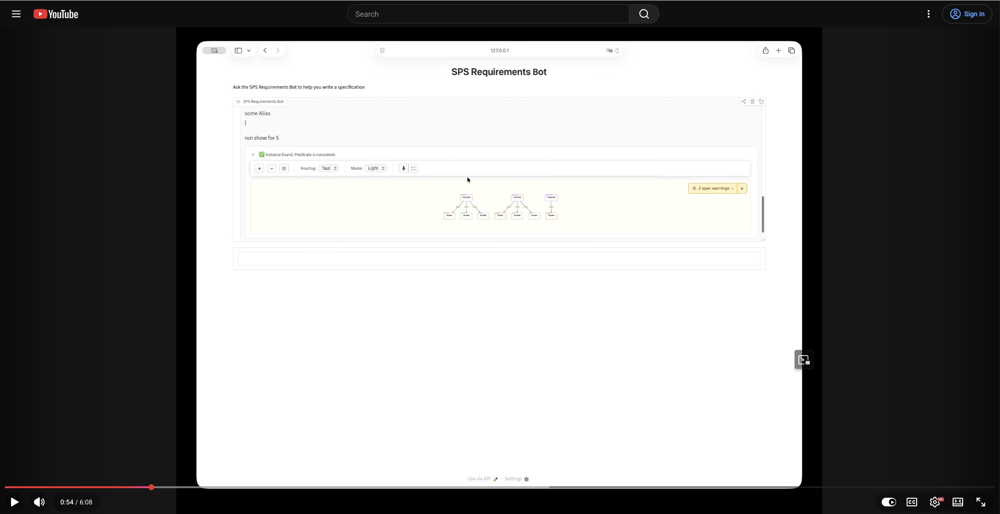
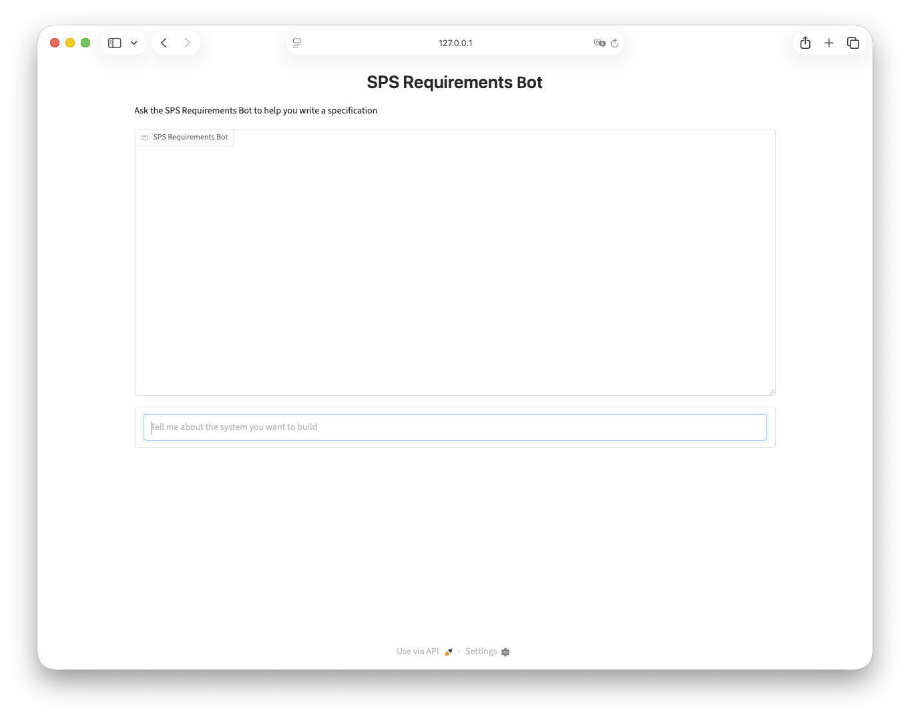

# About

Code, data, and notes related to my [Secure Program Synthesis Fellowship (SPS)](https://apartresearch.com/fellowships/the-secure-program-synthesis-fellowship) project.

# Demo video

[](https://www.youtube.com/watch?v=3LBcPdOi9F0 "Demo Video")

## Quickstart (Anthropic API edition)

### Prerequisites

Clone this repo, and perform these one-time setups:

- Install [uv](https://docs.astral.sh/uv/getting-started/installation/)
- Generate an [Anthropic API key](https://platform.claude.com/docs/en/api/overview#getting-api-keys)
- [Alloy](https://alloytools.org/)
  - Clone this [PR branch](https://github.com/dpapathanasiou/org.alloytools.alloy/tree/enhanced-cli-metdata) of the Alloy latest release (v6.2.0), [build](https://github.com/AlloyTools/org.alloytools.alloy#tldr) the jar (org.alloytools.alloy.dist.jar), and note the folder location
  - Requires [Java JRE 17](https://github.com/AlloyTools/org.alloytools.alloy?tab=readme-ov-file#tldr) - available via [SDKMAN!](https://sdkman.io/)

### Running

1. Define the required environment variables (can also save these to a `.env` file in the `~/path/to/sps-specification-elicitation/algobot/src/algobot` folder, which is not tracked by source control):

   ```sh
   SPS_BOT_MODEL = "anthropic/claude-opus-5-5"
   SPS_BOT_URL = "https://api.anthropic.com"
   SPS_BOT_MODEL_API_KEY = "sk...."
   SPS_ALLOY_JAR = "/usr/local/alloy/org.alloytools.alloy.dist.jar" # or where jar was saved
   SPS_DB_FILE = "/tmp/sps_db.sqlite3"
   ```

1. Activate the uv environment, and run the bot:
   ```sh
   cd ~/path/to/sps-specification-elicitation/
   cd algobot
   source .venv/bin/activate
   cd src/algobot
   uv run bot.py
   ```

1. Visit `http://127.0.0.1:7860/` in a web browser, and start describing your system requirements in plain language


